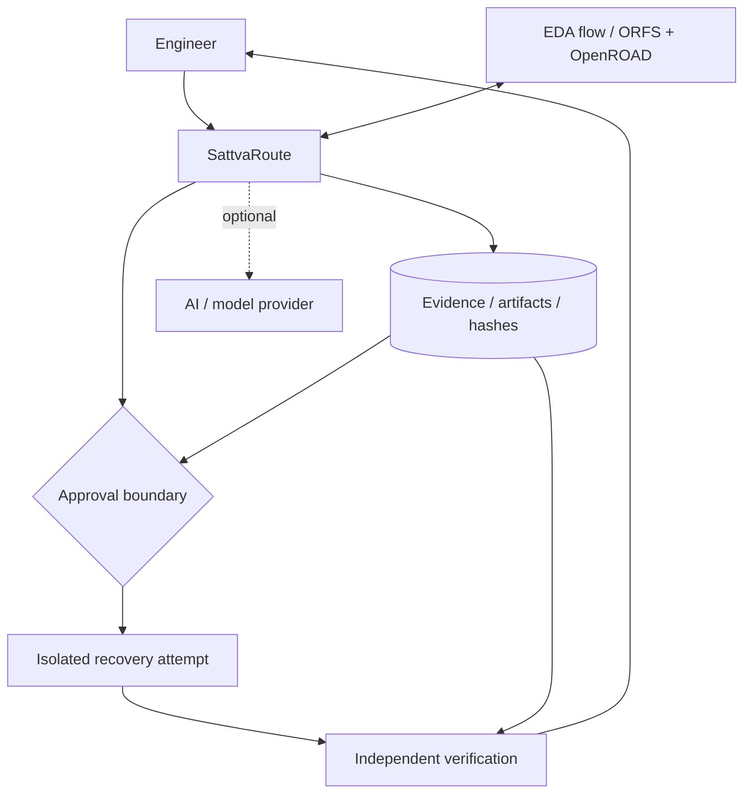

# SattvaRoute

**Evidence-driven physical-design diagnosis and controlled recovery for VLSI implementation workflows.**

SattvaRoute is a research-grade engineering framework that helps engineers investigate physical-design failures, identify evidence-supported causes, evaluate precise corrective actions, authorize changes, execute isolated recovery attempts, and independently verify outcomes. It does **not** replace a physical-design engineer, autonomously modify production designs, replace EDA tools, or claim signoff.

> Full authoritative narrative: [`docs/product/PRODUCT.md`](docs/product/PRODUCT.md).

## Problem

Physical-design failure debugging is slow and uncertain: failures are spread across logs and artifacts; error messages describe symptoms, not root causes; configuration and dependency state are ambiguous; timing units and collateral are often misstated; stale reports mislead; verification is incomplete; corrective changes are risky and hard to correlate with diagnosis; runs are hard to reproduce. See [`docs/product/PROBLEM.md`](docs/product/PROBLEM.md).

## Why SattvaRoute exists

To make diagnosis **evidence-driven**, preserve original state, bind proposed corrections to evidence, restrict changes to scope, require explicit human authorization, execute recovery in isolation, verify independently, and keep the whole process reproducible and auditable. **Clear engineering reasoning with a controlled path toward recovery.** See [`docs/product/NAMING.md`](docs/product/NAMING.md).

## Engineering philosophy

Evidence before conclusions; missing evidence stays missing; narrow corrective actions; preserve original state; human control; isolation; independent verification; honest outcomes; reproducibility. See [`docs/engineering/PHILOSOPHY.md`](docs/engineering/PHILOSOPHY.md).

## System overview

AI never controls the PnR flow directly. Python controls stage execution; OpenROAD executes; parsers extract evidence; AI analyzes and proposes (optional); an approval service authorizes; a deterministic controller applies approved patches and resumes; verification is independent.

Full diagrams: [`docs/architecture/`](docs/architecture/) · [`docs/diagrams/`](docs/diagrams/).

## Workflow

Failed run → evidence capture → artifact inspection → failure classification → root-cause analysis → evidence binding → candidate correction → validation → **explicit human approval** → apply approved op → isolated attempt → independent verification → recovery verdict. See [`docs/architecture/RECOVERY.md`](docs/architecture/RECOVERY.md) and [`docs/workflow/WORKFLOW.md`](docs/workflow/WORKFLOW.md).

## Core capabilities

Evidence collection & preservation; run isolation & preflight; reproducible manifests v2 + dependency fingerprinting; verified ORFS revision + local-patch checks; generalized bounded diagnosis; narrow reviewable proposals; exact-patch approval integrity; atomic apply + rollback evidence; stage-limited rerun; independent verification; timing-unit auditing; reproducible `nangate_macro_control` benchmark; evaluation v2 (frozen); held-out unseen case + approved recovery. **Deterministic** unless explicitly labeled model; no live AI without credentials. See capability matrix [`docs/reference/CAPABILITIES.md`](docs/reference/CAPABILITIES.md).

## Supported & validated scope

Offline suite: `python3 -m unittest discover -s tests -p 'test_*.py'` (**176 test methods** defined; targeted qualification suites **81/81 PASS**; full suite has 4 failures + 25 errors from pre-existing fixture/environment gaps — see `coordination/TASK_BOARD.md`). Validated **Nangate45 + `fakeram45_64x32` `nangate_macro_control`** control benchmark; **1 ns** `constraint_1ns.sdc` approved; historical **1000 ns** preserved; **ORFS `25b6429c…` + 2 local patches**; **not** multi-corner; **not** signoff. `DRT-0073`/OpenFinRAM **unresolved, not reopened**. See [`docs/research/LIMITATIONS.md`](docs/research/LIMITATIONS.md).

## Getting started

See [`docs/workflow/GETTING_STARTED.md`](docs/workflow/GETTING_STARTED.md). Requires pinned ORFS + OpenROAD + Yosys externally (not vendored). No credentials for offline tests.

## Documentation

Start at [`docs/DOCUMENTATION_INDEX.md`](docs/DOCUMENTATION_INDEX.md).

| Area | Entry |
|---|---|
| Product | [`docs/product/`](docs/product/) |
| Architecture | [`docs/architecture/`](docs/architecture/) |
| Engineering | [`docs/engineering/`](docs/engineering/) |
| Workflow | [`docs/workflow/`](docs/workflow/) |
| Security | [`docs/security/`](docs/security/) |
| Reproducibility | [`docs/reproducibility/`](docs/reproducibility/) + [`docs/REPRODUCIBILITY.md`](docs/REPRODUCIBILITY.md) |
| Reference | [`docs/reference/`](docs/reference/) |
| Governance | [`docs/governance/`](docs/governance/) |
| Research | [`docs/research/`](docs/research/) |
| Existing evidence | [`docs/`](docs/) + [`evidence/`](evidence/) |

## Reproducibility

Manifest v2, verified revision, pinned collateral + checksums, no author paths, no untracked reliance, no bulk artifacts; see [`docs/REPRODUCIBILITY.md`](docs/REPRODUCIBILITY.md). Not another-engineer tested.

## Safety model

Nothing applied without explicit human approval of exact displayed diff; no force-push; no unsafe patch; no invented collateral; no constraint relaxation; originals/history preserved; `PASS/FAIL/BLOCKED/UNKNOWN/INCONCLUSIVE/NOT RUN/NOT EVALUATED`; missing evidence not success. See [`docs/security/`](docs/security/).

## Current limitations

Pass-through wrapper; abstract FakeRAM; single typical corner; trivial timing; not timing-closure-representative; no foundry DRC/LVS/signoff; no functional correctness; no live-AI recovery without credentials; `DRT-0073` unresolved; not another-engineer tested. Curated provenance records for the 1 ns runs contain absolute `/mnt/d/...` paths identifying the executed target and backups; these are evidence identity, not required local setup paths. See [`docs/research/LIMITATIONS.md`](docs/research/LIMITATIONS.md).

## Research direction

Evidence-grounded EDA agents; cross-stage reasoning; constraint intelligence; physical-design failure knowledge; safe agentic engineering; multi-agent diagnosis; recovery-quality metrics; independent reproduction. **Planned/research, not delivered.** [`docs/research/ROADMAP.md`](docs/research/ROADMAP.md).

## Contributing

See [`CONTRIBUTING.md`](CONTRIBUTING.md) + [`AGENTS.md`](AGENTS.md). Documentation-only vs engineering changes separated. No fabricated results.

## Evidence-to-verdict qualification (2026-11-27)

- Clean-environment 1 ns baseline: `orfs_baseline_clean_1ns_validation2_20261127T155308953691633Z_332` (`rc=0`). Report-level checks PASS; `timing_update` is `UNKNOWN` because the pinned OpenROAD has no `update_timing` command. No signoff or functional-correctness claim.
- Isolated 1 ns missing-LEF regression: `orfs_baseline_failure_1ns_lef2_20261127T160852041068605Z_393` (`rc=2` at `synth`).
- Human-approved recovery: patch hash `02ebf21a75511a6ac594c635a9f4fd4db3782d362d6d861c800273f1e65818d2`, applied under `AP-CLEAN-1NS-LEF-005`; recovery run `orfs_baseline_recovery_1ns_lef6_20261127T164249693060081Z_361` (`rc=0`, all six approved stages at 1 ns).
- Comparison: `evidence/verification/clean_1ns_recovery.json` — every executable check passes (approval, failure marker, target clearing, scope, same-target, routing, extraction, artifacts), but the overall verdict remains **`FAIL`** because the baseline is `UNKNOWN` on `timing_update`. Recovery passed all executable checks and remains **unqualified for collateral timing regression**. This is verifier integrity, not a timing failure; the missing check is never converted to PASS.
- Setup inputs published: `patches/orfs/` (exact diffs + manifest), `scripts/check_setup_patches.py`, `scripts/setup_preflight.py`. Frozen `evaluate_diagnosis_v2.py` unchanged; `evaluate_diagnosis_v3.py` adds strict correction-identity checks.

## License

Original SattvaRoute code + docs: **MIT** (`LICENSE`, `Copyright (c) 2026 SattvaRoute contributors`). MIT covers **original only**; third-party tools/PDKs/libraries/macro collateral separate (`THIRD_PARTY_NOTICES.md`, `docs/governance/LICENSING.md`). No license change in this milestone.

## Security

Report privately per [`SECURITY.md`](SECURITY.md). No credentials in repo. See `docs/security/THREAT_MODEL.md`.

## Citation

See [`CITATION.cff`](CITATION.cff).
