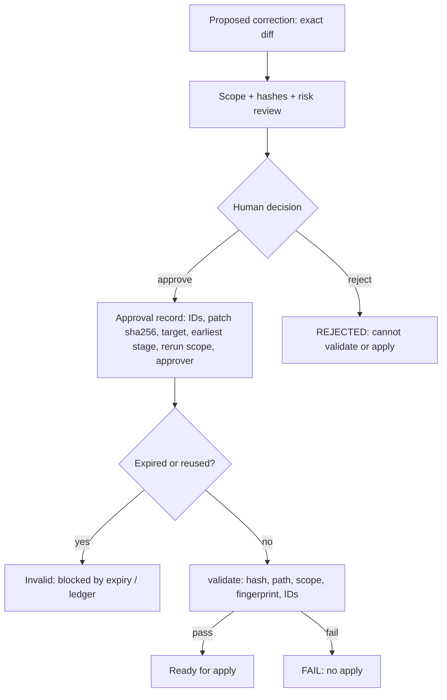

# Diagram D — Approval lifecycle

Status: implemented. Expiration is optional (`--expires-at`), shown as optional.

Notes: the CLI never manufactures an approval. Ledger is append-only; `validate` rejects reuse and unsafe scope. See `docs/architecture/APPROVAL.md`, `docs/security/SAFETY.md`.
