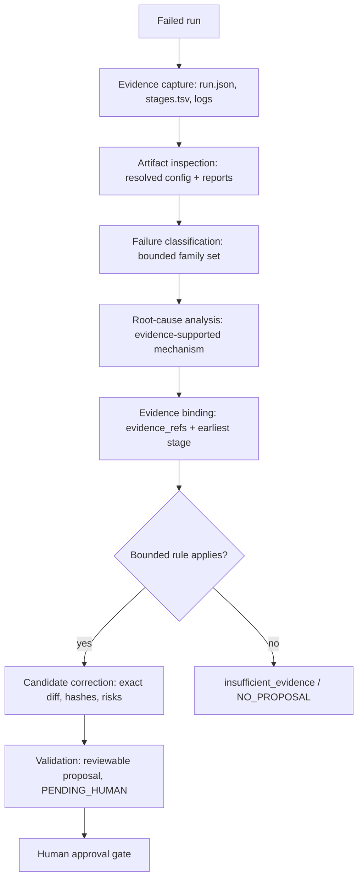

# Diagram C — Failure diagnosis lifecycle

Status: implemented deterministic lifecycle.

Notes: an error message is a symptom, not a root cause. Missing evidence stays missing. A right-hand branch must not become a guessed fix. See `docs/architecture/DIAGNOSIS.md`, `docs/engineering/FAILURE_TAXONOMY.md`.
