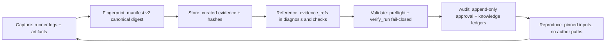

# Diagram F — Evidence lifecycle

Status: implemented capture/fingerprint/reference/validation; audit and reproducibility are documented properties.

Notes: missing evidence is never a pass; declared expectations are separate from captured fingerprints. Bulk databases are not published; local paths are not public evidence. See `docs/architecture/EVIDENCE.md`, `docs/security/EVIDENCE_INTEGRITY.md`.
