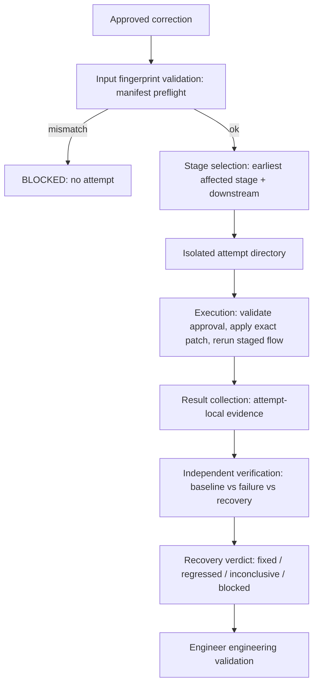

# Diagram E — Recovery lifecycle

Status: implemented, deterministic and approval-gated. No live-AI recovery.

Notes: originals and baseline are preserved; the runner return code is not the verdict. Verified example: `docs/HELDOUT_RECOVERY.md`. See `docs/architecture/RECOVERY.md`, `docs/architecture/VERIFICATION.md`.
