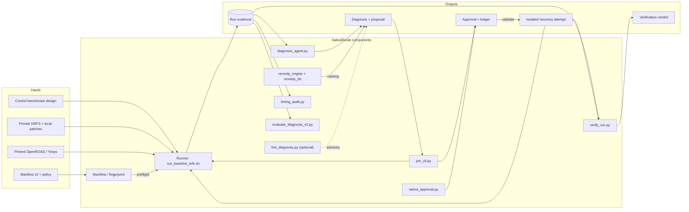

# Diagram B — System architecture

Status: implemented components. Source files are named in `docs/architecture/ARCHITECTURE.md`.

Notes: propose, approve, apply, execute, verify are distinct components. No component both proposes and approves. See `docs/architecture/ARCHITECTURE.md`, `docs/reference/CAPABILITIES.md`.
