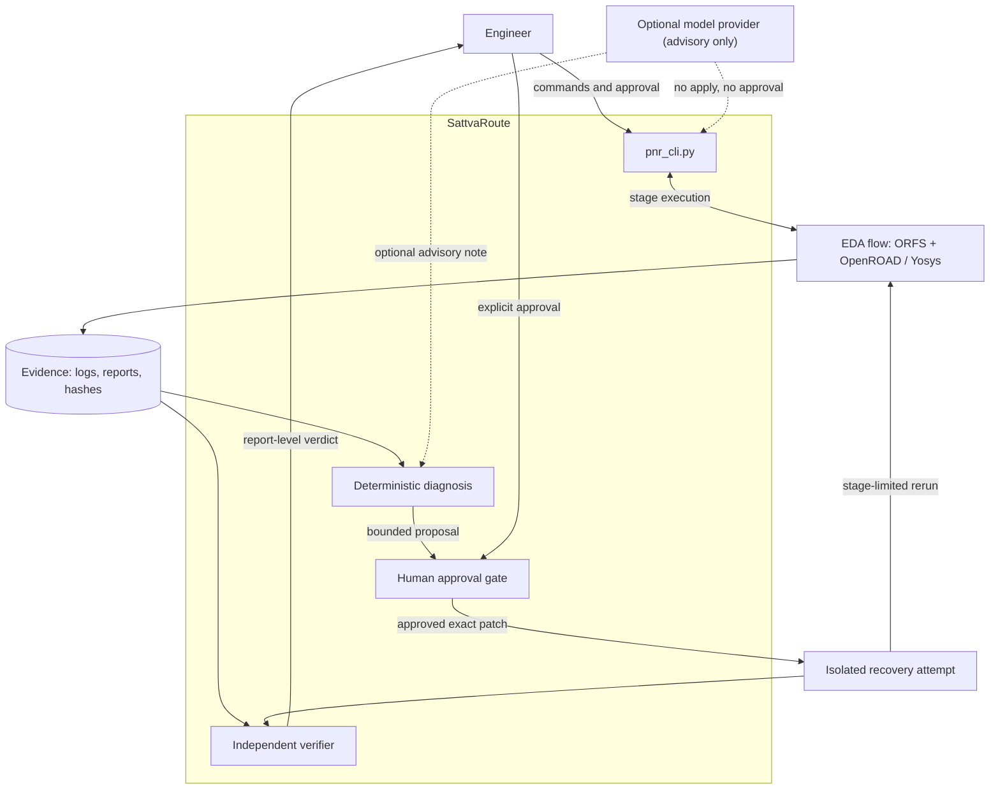

# Diagram A — System context

Status: implemented context. Optional model path is shown dashed; no live-AI recovery.

Notes: AI never controls the flow directly. Approval is a human boundary. Verification reads evidence and attempts but applies nothing. See `docs/reference/GLOSSARY.md`, `docs/security/TRUST_BOUNDARIES.md`.
