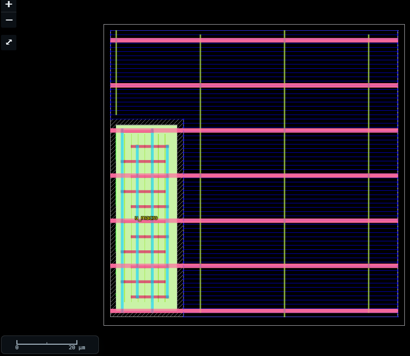
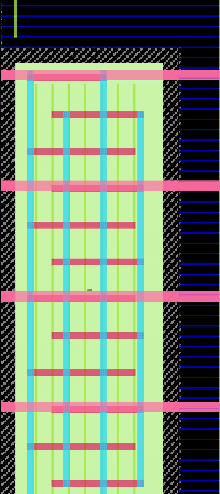
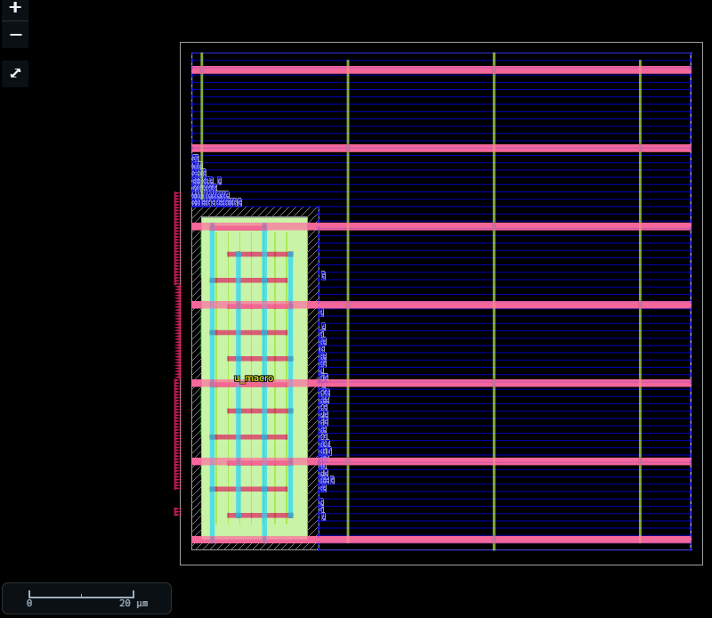
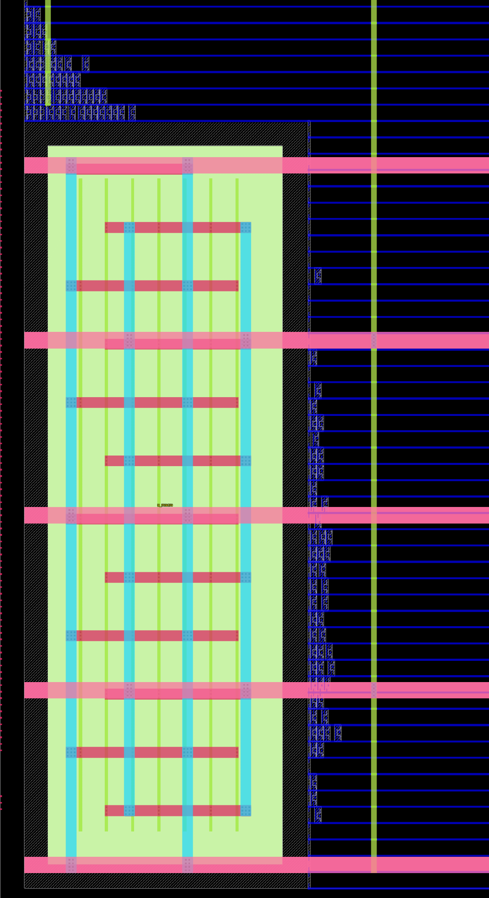
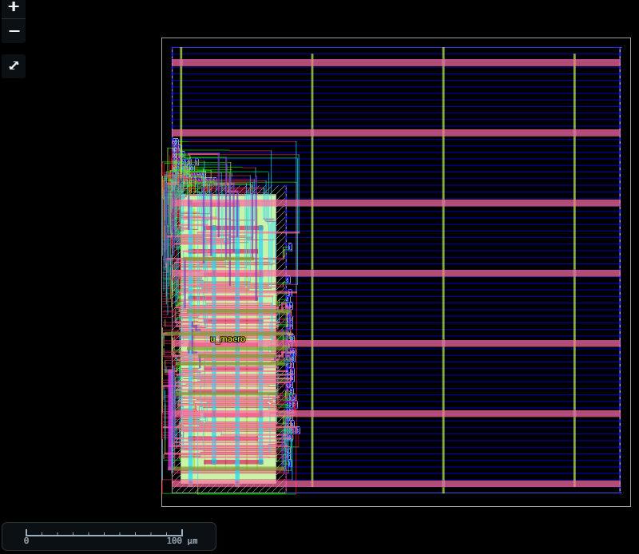
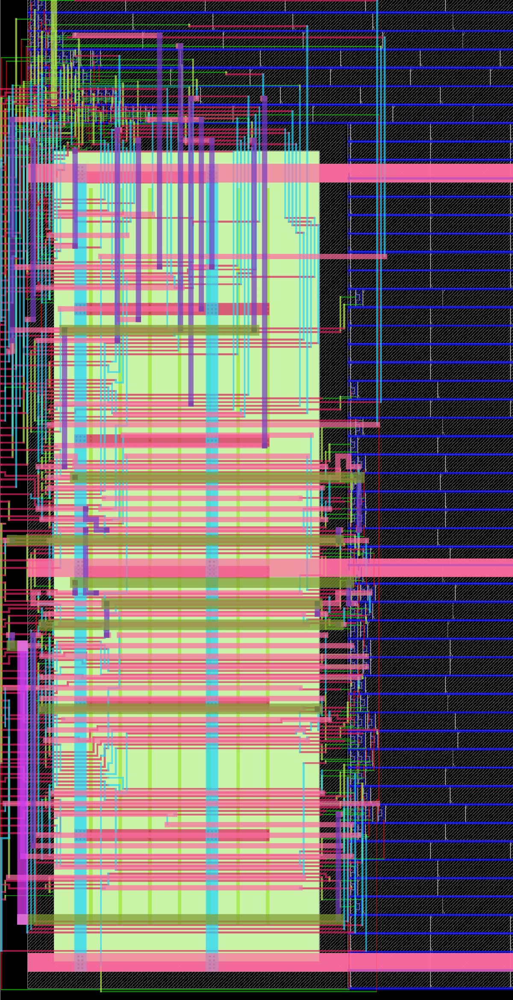
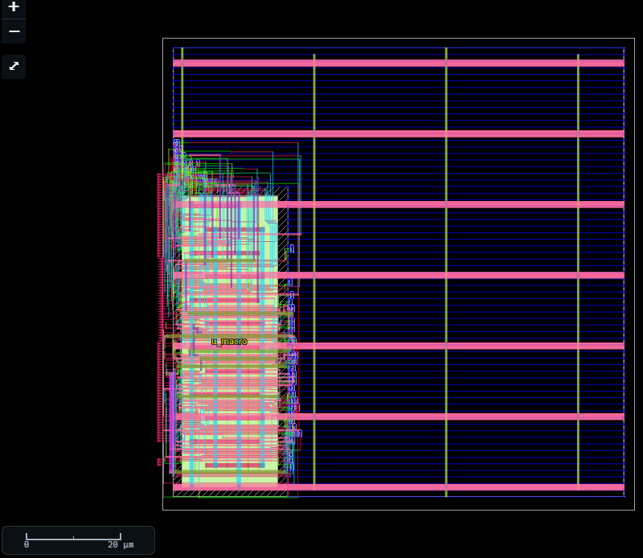

# Real-run physical-design gallery

Two perspectives on one real OpenROAD execution: **full-die context** and **engineering detail** rendered directly from the saved databases at stage-specific zoom. No engineering stage was rerun, and no upstream ORFS example images are used.

## Run identification

| Item | Value |
|---|---|
| Run ID | `orfs_baseline_control_1ns_20261126T133241476241945Z_4600` |
| Design profile | `nangate_macro_control` (Nangate45 + abstract `fakeram45_64x32` macro) |
| Top | `sattva_macro_top` |
| SDC | `constraint_1ns.sdc` — clock period **1 ns** |
| ORFS | `25b6429c1644a8682852646bebf19ff164402c76` + two declared local patches |
| OpenROAD | `bazel-nostamp` (`c1b90e0a…`) |
| Run outcome | 8 stages, all `rc=0`; engineering verdict remains `NOT EVALUATED` |

Detail images are generated with OpenROAD's **headless web-mode** `save_image -web` directly from each saved ODB at the micron areas recorded in the manifest. They are not upscaled crops of the full-die screenshots. The GUI form of `save_image` is unavailable because this build has no Qt GUI; `save_image -web` is a separate supported rendering path. Detail areas differ by stage, so the full-die/detail pairs are comparable by content (macro, straps, cells, routes), not by pixel position.

## Floorplan

**Full-die context** — abstract macro and power-strap grid across the die.

**Engineering detail** — macro dimensions, blockage, boundary and surrounding power structures.

[Raw capture](runs/orfs_baseline_control_1ns_20261126T133241476241945Z_4600/original/floorplan.png) · [Source: `2_floorplan.odb`]

## Placement

**Full-die context** — legalized cells relative to the die and macro.

**Engineering detail** — cell clusters beside and around the macro; placement density and distribution are easier to inspect.

[Raw capture](runs/orfs_baseline_control_1ns_20261126T133241476241945Z_4600/original/placement.png) · [Source: `3_place.odb`] · The placement log reports an INFO-level congestion concern despite `rc=0`.

## CTS

**Full-die context** — saved `4_cts.odb`.

**No detail image is published.** A clock-visibility render was attempted from the saved database, but no distinct clock trunk, spine, or buffer chain is visible at this scale; the stage image differs from placement by 2,451 pixels inside the die (0.71% of the die rectangle, exact-colour comparison). CTS metrics are authoritative in `4_cts_final.rpt`, which reports "No launch/capture paths found".

[Raw capture](runs/orfs_baseline_control_1ns_20261126T133241476241945Z_4600/original/cts.png)

## Routing

**Full-die context** — routed nets after detailed routing.

**Engineering detail** — routed segments and vias around the macro and active region.

[Raw capture](runs/orfs_baseline_control_1ns_20261126T133241476241945Z_4600/original/routing.png) · [Source: `5_route.odb`] · DRT-0199 counts `[159, 37, 32, 6, 6, 0]`, final `0`.

## Final

**Full-die context** — final tool-generated implementation from `6_final.odb`. No separate detail image is published: it would duplicate the routing detail.

[Raw capture](runs/orfs_baseline_control_1ns_20261126T133241476241945Z_4600/original/final.png)

## Metrics summary

| Stage | rc | Authentic tool-level metric | Source |
|---|---:|---|---|
| Floorplan | 0 | 1 macro instance (GRT census; abstract macro) | `evidence/stage_route.log` |
| Placement | 0 | Final weighted congestion 1.5015; INFO "could not reach target" | `evidence/stage_place.log` |
| CTS | 0 | 1 ns clock; "No launch/capture paths found" | `4_cts_final.rpt` |
| Routing | 0 | DRT-0199 final 0; 209 routed nets; GRT congestion 4.48% | `evidence/stage_route.log` |
| Final | 0 | TNS 0.00, WNS 0.00, worst slack 0.64, fmax 2760.00 | `6_finish.rpt` |

Independent verification: [`baseline_1ns_verify.json`](../../evidence/verification/baseline_1ns_verify.json) — overall `PASS` at tool level, DRT final 0. The remaining source reports and logs live in the original external run tree (paths recorded in the manifest); they are not duplicated in this repository.

## Technical limitations

1. Images originate from **one real OpenROAD execution** and this run only.
2. The macro is an **abstract FakeRAM**, not a characterized foundry SRAM.
3. **Placement reported a congestion concern** even though the stage returned `rc=0`.
4. Final router violations of **zero do not imply foundry signoff**.
5. **No external DRC/LVS or signoff verification** is claimed.
6. All metrics are **tool-level results**; `rc=0` is not engineering acceptance, and the run's engineering verdict remains `NOT EVALUATED`.
7. The **source commit SHA is unavailable** for this run and is reported as `NOT_AVAILABLE`, not inferred.
8. **CTS details are visually subtle** at this zoom; no clock-tree detail image is published.
9. The routing full-die image's scale bar reads `100 μm` while the other four read `20 μm`, with an identical die footprint in pixels — a viewer artefact. No physical distance is inferred from these bars.
10. Detail images are tool-rendered from the saved ODBs; full-view raw captures are retained for traceability.

## Provenance

- [manifest.json](runs/orfs_baseline_control_1ns_20261126T133241476241945Z_4600/manifest.json) — raw ODB/image hashes, full-die and detail derivative hashes, render areas, capture method, report paths, source-commit status.
- [notes.md](runs/orfs_baseline_control_1ns_20261126T133241476241945Z_4600/notes.md) — capture narrative, CTS investigation, limitations.
- [capture_stage.tcl](runs/orfs_baseline_control_1ns_20261126T133241476241945Z_4600/capture_stage.tcl) — the load-only Tcl script used for the original captures.
- Background audit: [`docs/audit/VISUAL_EVIDENCE_CAPABILITY_AUDIT.md`](../audit/VISUAL_EVIDENCE_CAPABILITY_AUDIT.md).
